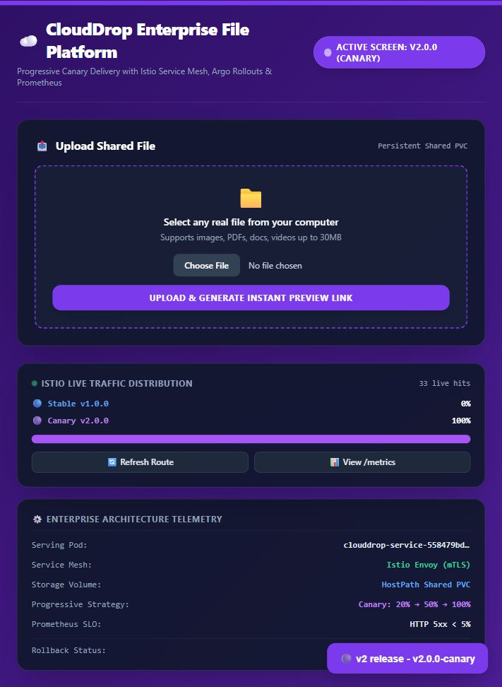

# CloudDrop — Progressive Delivery & Service Mesh

> A file-sharing application demonstrating canary deployments, SLO analysis, and automated rollback with Kubernetes, Istio, Argo Rollouts, and Prometheus.

---

## 🌟 Overview
CloudDrop lets users upload files, share preview links, and download stored
files. The project demonstrates how to release application updates gradually
while checking real request metrics before sending more traffic to a candidate.

The local platform runs in Docker Desktop and a single-node Kind cluster:
* **Layer 7 Traffic Splitting:** Dynamic canary routing (20% ➔ 50% ➔ 100%) via **Istio Envoy proxies**.
* **Automated SLO Analysis:** Real-time **Prometheus PromQL queries** evaluating HTTP 5xx error rates and latency before advancing traffic.
* **Analysis-Based Rollback:** Failed canary analysis returns traffic to the last healthy release. Timing follows the configured measurement schedule and controller reconciliation.
* **Service Mesh mTLS:** Istio `DestinationRules` configure **ISTIO_MUTUAL** for stable and canary service connections.

---

## 📐 System Architecture


The diagram follows the implemented local system: Docker Desktop and Kind,
Istio ingress on `localhost:8082`, blue/purple application releases, shared PVC
storage, and the Prometheus/Argo analysis loop. It also separates GitHub Actions
image publishing from the script-driven local deployment path.

[Read the full architecture and release flow](docs/architecture.md).

---

## 🏗️ Project Structure

```text
progressive-delivery-service-mesh/
├── .github/workflows/
│   ├── build-and-test.yaml        # Backend tests, dependency audit, Docker build
│   └── release.yaml               # Tests and publishes an image to GHCR on version tags
├── apps/fileshare/                # CloudDrop application
│   ├── backend/
│   │   ├── src/
│   │   │   ├── server.js          # Express startup, frontend serving, request telemetry
│   │   │   ├── config/            # Version, theme, port, and storage settings
│   │   │   ├── controllers/       # File operations and simulated request failures
│   │   │   ├── routes/            # API endpoints, health, metrics, and checkout traffic
│   │   │   └── metrics/           # Prometheus counters and duration histograms
│   │   ├── tests/                 # Health, checkout, failure, metrics, and upload tests
│   │   ├── package.json           # Dependencies and application commands
│   │   └── package-lock.json      # Locked dependency versions for reproducible installs
│   ├── frontend/
│   │   ├── src/                   # React components for uploads, previews, traffic display
│   │   └── dist/                  # Browser page currently bundled into the Docker image
│   ├── Dockerfile                 # Packages the backend and frontend in one Node.js image
│   ├── .dockerignore              # Excludes local dependencies and unnecessary build files
│   └── manifests/
│       ├── rollout.yaml           # Replicas and 20% → 50% → 100% canary steps
│       ├── analysis-template.yaml # Prometheus error-rate and p95 latency checks
│       ├── services.yaml          # Stable and canary Kubernetes Services
│       ├── istio-networking.yaml  # Gateway and weighted VirtualService routing
│       ├── destinationrule.yaml   # Service connection policies, including mTLS
│       └── pvc.yaml               # Shared persistent storage claim for uploaded files
├── infrastructure/
│   └── kind-config.yaml           # Local cluster definition and host-port mappings
├── platform/
│   ├── istio/                     # Istio installation and ingress configuration
│   ├── prometheus/                # Monitoring settings, including 10-second scraping
│   └── argo-rollouts/             # Supporting dashboard service configuration
├── scripts/
│   ├── setup.ps1                  # Configures the cluster, platform, images, and application
│   ├── promote-v2.ps1             # Submits v2, generates traffic, and watches the rollout
│   ├── generate-traffic.ps1       # Sends synthetic requests to /checkout
│   └── trigger-chaos.ps1          # Submits a canary with simulated application failures
├── docs/
│   ├── architecture.md            # Application, monitoring, and delivery flow explanations
│   ├── images/                    # Architecture diagram and generation prompt
│   └── evidence/                  # Demo screenshots and recorded analysis results
├── .gitignore                     # Excludes dependencies and local runtime files
└── README.md                      # Overview, setup instructions, and demonstrations
```

**Application flow:** the browser reaches Istio, which routes requests to a
stable or canary pod. CloudDrop handles the API request and accesses uploaded
files through the shared PVC.

**Deployment flow:** the local scripts submit a candidate release. Argo changes
traffic weights, queries Prometheus, and either promotes the candidate or returns
traffic to the last healthy release.

GitHub Actions publishes release images but does not deploy them automatically
to the local cluster. The Dockerfile copies `frontend/dist` directly; the current
pipeline does not compile `frontend/src` into that page.

---

## 🚀 Quickstart

### Prerequisites
* Windows with PowerShell and Git
* Docker Desktop running with Linux containers
* `kind`, `kubectl`, and `helm` available on your PATH
* Internet access for container images, Helm charts, and the frontend CDN assets
* Node.js 24 if you want to run backend tests outside Docker

### 1. Clone and set up the local platform

```powershell
git clone https://github.com/Jeffrin2005/progressive-delivery-service-mesh.git
cd progressive-delivery-service-mesh
.\scripts\setup.ps1
```

Setup creates the cluster, installs the platform components, builds and loads
application images, and applies the manifests. Initial downloads and image
imports can take several minutes, depending on your connection and computer.

If you already have the repository, run the script from its root directory.

### 2. Verify readiness and open the application

```powershell
kubectl config use-context kind-progressive-delivery
kubectl wait --for=condition=Ready nodes --all --timeout=180s
kubectl wait --for=condition=Healthy rollout/clouddrop-service -n prod --timeout=300s
kubectl get pods -n prod
curl.exe http://localhost:8082/health
```

The node should be `Ready`, the application pods should report `2/2 Running`,
and the health endpoint should return `HEALTHY` with the application version.

* **Web Portal:** Open `http://localhost:8082/` in your browser.
* **Health Check:** `http://localhost:8082/health`
* **Metrics:** `http://localhost:8082/metrics`

### 3. Run backend tests (optional)

```powershell
npm ci --prefix apps/fileshare/backend
npm test --prefix apps/fileshare/backend
```

---

## 🧪 Demonstrations

### Verified Local Promotion

The local demonstration completed blue v1 → 20% purple v2 → 50% purple v2 →
100% purple v2. Both Prometheus analysis stages passed, and the final four
application pods were `2/2 Running`. A separate missing-data analysis failed as
expected, confirming that empty metrics do not approve a release.

| Blue v1 before promotion | Purple v2 after promotion |
| --- | --- |
|  |  |

[Recorded rollout measurements](docs/evidence/rollout-verification.json)

Rollback during canary analysis returns traffic to the last healthy release.
After v2 is promoted, v2 is the stable release; a later failed canary rolls back
to v2. Step-based analysis does not keep triggering rollbacks after promotion.

### 1. Progressive Canary Rollout
```powershell
docker build -t clouddrop-service:v2.0.0-live-demo apps/fileshare
kind load docker-image clouddrop-service:v2.0.0-live-demo --name progressive-delivery
.\scripts\promote-v2.ps1
```

The script generates checkout traffic while Argo automatically evaluates v2 at
20% and 50%, then promotes it to 100%. It stops traffic when the rollout completes
or fails. The page changes from blue v1 to purple v2 and refreshes release metadata
every two seconds; the live-hit counter samples `/api/ping` every 500 ms.
The displayed percentages summarize requests since the page was loaded; they
are not the configured Istio routing weights. Refresh the page to reset those
samples when demonstrating a new stage. After promotion, v2 becomes Argo's stable
ReplicaSet and serves all traffic.

For subsequent builds, use a fresh image tag and pass it with `-Image`; changing
only the contents of an already-running image tag does not trigger a rollout.

Prometheus must scrape every 10 seconds for the one-minute analysis windows:

```powershell
helm upgrade prometheus prometheus-community/prometheus --version 29.47.2 -n istio-system --reuse-values --set server.global.scrape_interval=10s --set server.global.scrape_timeout=5s --set server.global.evaluation_interval=10s --wait
```

These settings are also saved in `platform/prometheus/prometheus-values.yaml` for
future setup runs. The analysis requires at least ten observed checkout requests,
at most 5% HTTP 5xx errors, and p95 latency at most 750 ms. Missing traffic or empty
query results do not pass. Keep traffic running throughout both analysis stages.

### 2. Generate Live Customer Traffic
```powershell
.\scripts\generate-traffic.ps1 -Requests 50
```

### 3. Inject Chaos & Watch Auto-Rollback
```powershell
.\scripts\trigger-chaos.ps1 -Percentage 100
```

---

## 📚 Documentation
* [Detailed Architecture & Flow Diagram](docs/architecture.md)
