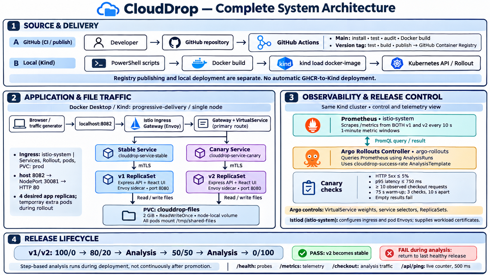
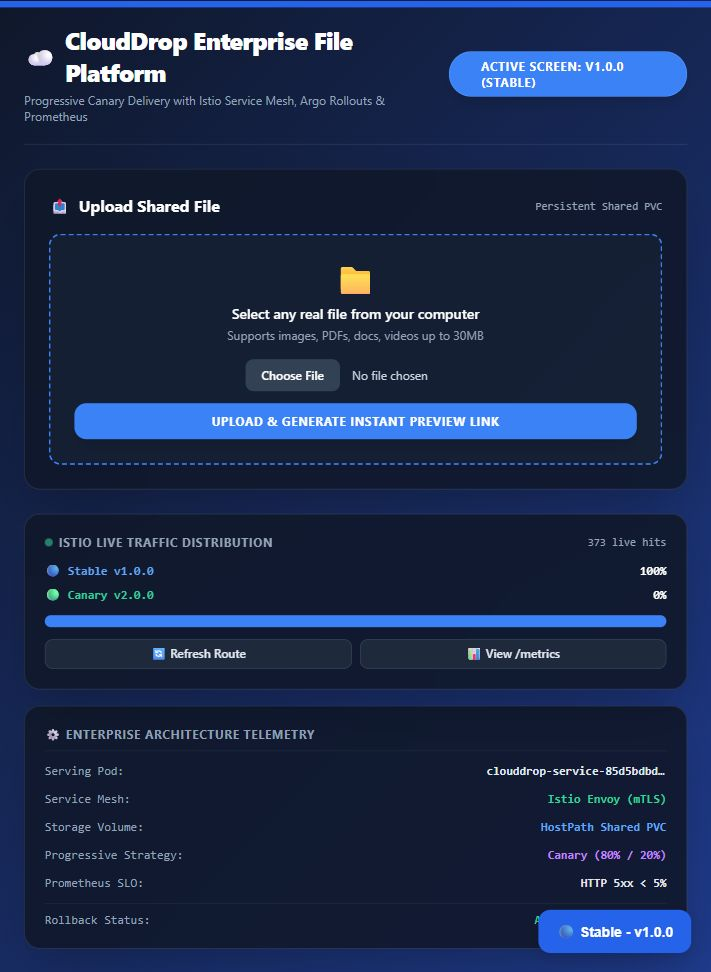

# 🛡️ Enterprise Progressive Delivery & Service Mesh Platform

> **Zero-Downtime Canary Deployments & SLO-Based Automated Rollbacks with Istio, Argo Rollouts, and Prometheus.**

---

## 🌟 Overview
In enterprise architectures (fintech, e-commerce, banking), standard Kubernetes `RollingUpdate` deployments are dangerous: a subtle bug can pass basic readiness checks and replace 100% of healthy pods, causing a full production outage.

This repository demonstrates an **end-to-end Progressive Delivery & SRE solution**:
* **Layer 7 Traffic Splitting:** Dynamic canary routing (20% ➔ 50% ➔ 100%) via **Istio Envoy proxies**.
* **Automated SLO Analysis:** Real-time **Prometheus PromQL queries** evaluating HTTP 5xx error rates and latency before advancing traffic.
* **Analysis-Based Rollback:** Failed canary analysis returns traffic to the last healthy release. Timing follows the configured measurement schedule and controller reconciliation.
* **Service Mesh mTLS:** Istio `DestinationRules` configure **ISTIO_MUTUAL** for stable and canary service connections.

---

## 📐 System Architecture



The diagram follows the implemented local system: Docker Desktop and Kind,
Istio ingress on `localhost:8082`, blue/purple application releases, shared PVC
storage, and the Prometheus/Argo analysis loop. It also separates GitHub Actions
image publishing from the script-driven local deployment path.

[Read the full architecture and release flow](docs/architecture.md).

---

## 🏗️ Repository Architecture

```text
Progressive Delivery devops2/
├── .github/workflows/             # GitHub Actions CI/CD (Test, Lint & Canary Release)
├── apps/
│   └── fileshare/                 # CloudDrop File Sharing Microservice
│       ├── backend/               # Node.js Express API with /metrics & shared volume
│       ├── frontend/              # React 18 Telemetry Dashboard & Upload UI
│       ├── Dockerfile             # Node.js container with bundled frontend
│       └── manifests/             # Kubernetes Rollout, VirtualService, Services & mTLS
├── infrastructure/                # Local Kind cluster configuration
├── platform/                      # Core Mesh & Observability (Istio, Prometheus, Argo Rollouts)
├── scripts/                       # Chaos Engineering & Traffic Simulation Scripts
└── docs/                          # Architecture Diagrams & Documentation
```

---

## 🚀 Quickstart (Run Locally in 5 Minutes)

### Prerequisites
* Docker Desktop (running)
* `kind`, `kubectl`, and `helm` installed

### 1. One-Click Automated Setup
```powershell
.\scripts\setup.ps1
```

### 2. Access the Application
* **Web Portal:** Open `http://localhost:8082/` in your browser.
* **Health Check:** `http://localhost:8082/health`
* **Metrics:** `http://localhost:8082/metrics`

---

## 🧪 Demonstrations

### Verified Local Promotion

The local demonstration completed blue v1 → 20% purple v2 → 50% purple v2 →
100% purple v2. Both Prometheus analysis stages passed, and the final four
application pods were `2/2 Running`. A separate missing-data analysis failed as
expected, confirming that empty metrics do not approve a release.

| Blue v1 before promotion | Purple v2 after promotion |
| --- | --- |
|  |  |

[Recorded rollout measurements](docs/evidence/rollout-verification.json)

Rollback during canary analysis returns traffic to the last healthy release.
After v2 is promoted, v2 is the stable release; a later failed canary rolls back
to v2. Step-based analysis does not keep triggering rollbacks after promotion.

### 1. Progressive Canary Rollout
```powershell
docker build -t clouddrop-service:v2.0.0-live-demo apps/fileshare
kind load docker-image clouddrop-service:v2.0.0-live-demo --name progressive-delivery
.\scripts\promote-v2.ps1
```

The script generates checkout traffic while Argo automatically evaluates v2 at
20% and 50%, then promotes it to 100%. It stops traffic when the rollout completes
or fails. The page changes from blue v1 to purple v2 and refreshes release metadata
every two seconds; the live-hit counter samples `/api/ping` every 500 ms.
The displayed percentages summarize requests since the page was loaded; they
are not the configured Istio routing weights. Refresh the page to reset those
samples when demonstrating a new stage. After promotion, v2 becomes Argo's stable
ReplicaSet and serves all traffic.

For subsequent builds, use a fresh image tag and pass it with `-Image`; changing
only the contents of an already-running image tag does not trigger a rollout.

Prometheus must scrape every 10 seconds for the one-minute analysis windows:

```powershell
helm upgrade prometheus prometheus-community/prometheus --version 29.47.2 -n istio-system --reuse-values --set server.global.scrape_interval=10s --set server.global.scrape_timeout=5s --set server.global.evaluation_interval=10s --wait
```

These settings are also saved in `platform/prometheus/prometheus-values.yaml` for
future setup runs. The analysis requires at least ten observed checkout requests,
at most 5% HTTP 5xx errors, and p95 latency at most 750 ms. Missing traffic or empty
query results do not pass. Keep traffic running throughout both analysis stages.

### 2. Generate Live Customer Traffic
```powershell
.\scripts\generate-traffic.ps1 -Requests 50
```

### 3. Inject Chaos & Watch Auto-Rollback
```powershell
.\scripts\trigger-chaos.ps1 -Percentage 100
```

---

## 📚 Documentation
* [Detailed Architecture & Flow Diagram](docs/architecture.md)
