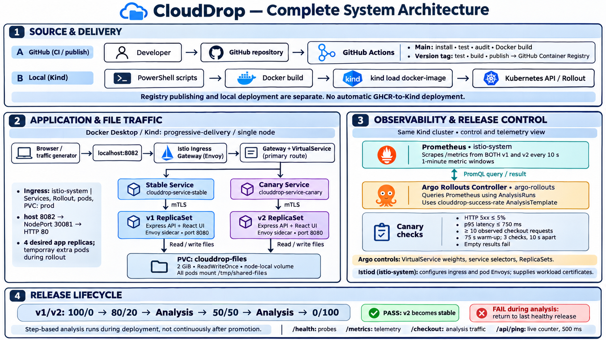

# CloudDrop System Architecture

CloudDrop is a file-sharing application running in a single-node Kind cluster
inside Docker Desktop. It combines a React interface, a Node.js/Express API,
Istio traffic routing, Argo Rollouts, Prometheus analysis, and shared file storage.

## Request and file flow

1. The browser opens `http://localhost:8082/`. Kind maps host port `8082` to
   NodePort `30081`, which exposes the Istio ingress service on HTTP port `80`.
2. The `clouddrop-gateway` and `clouddrop-virtualservice` resources in `prod`
   configure ingress routing. The VirtualService splits requests between
   `clouddrop-service-stable` and `clouddrop-service-canary` using Argo-managed
   weights. These are configuration resources, not extra proxy processes.
3. Each application pod has an Express container on port `8080` and an Envoy
   sidecar. Express serves the React page and file APIs from the same image.
   Istiod supplies proxy configuration and workload certificates. DestinationRules
   configure `ISTIO_MUTUAL` for both services; this alone does not enforce a
   cluster-wide strict inbound mTLS policy.
4. Both releases mount the `clouddrop-files` PVC at `/tmp/shared-files`. It
   requests `2Gi` with `ReadWriteOnce` access. Multiple replicas can share it
   on the same Kind node. Uploads use a local persistent volume. This is a
   local demonstration, not distributed storage for multiple nodes.

## Release control and observability

The controller in `argo-rollouts` watches the Rollout in `prod`, manages
ReplicaSets and service selectors, creates AnalysisRuns, and changes the
Istio VirtualService weights. Four application replicas are desired; extra
pods can coexist temporarily during a canary release.

Prometheus runs in `istio-system` and scrapes annotated pods every **10 seconds**.
With Istio injection, the sidecar can expose a merged scrape endpoint containing
the app metrics. HTTP telemetry comes from the application, not the file volume.
Argo queries `prometheus-server.istio-system.svc.cluster.local:80`.

| Endpoint | Role |
| --- | --- |
| `/health` | Readiness/liveness probes and application version |
| `/metrics` | Request counters and duration histograms |
| `/checkout` | Synthetic canary error/latency analysis traffic |
| `/api/ping` | Browser traffic samples every 500 ms |
| `/api/meta` | Release metadata, refreshed every two seconds by the current built page |
| `/api/upload-file` | Save an uploaded file to the shared volume |
| `/api/file/:fileId` | File metadata for the preview |
| `/download/raw/:fileId` | Download the stored file |

### Canary sequence

The demonstration deploys blue `v1.0.0` and purple `v2.0.0-canary`. The manifest's
analysis arguments currently name v2 explicitly; a differently named future
release must update those arguments to match its `APP_VERSION`.

| Stage | v1 traffic | v2 traffic | Gate |
| --- | ---: | ---: | --- |
| Initial release | 100% | 0% | v1 ready |
| First canary stage | 80% | 20% | 30-second pause, then analysis |
| Second canary stage | 50% | 50% | 30-second pause, then analysis |
| Successful promotion | 0% | 100% | v2 becomes the stable ReplicaSet |

Each metric waits **75 seconds**, then takes **three measurements** at
**10-second intervals**, using one-minute Prometheus windows:

- The checkout HTTP 5xx fraction must be at most **5%**.
- The error-rate query requires at least **10 observed checkout requests**.
- Checkout p95 latency must be at most **750 ms**.
- Empty query results fail. Invalid or inconclusive measurements cannot
  satisfy the success conditions.

`scripts/promote-v2.ps1` submits the image and runs checkout traffic through
`scripts/generate-traffic.ps1` until completion or failure. Browser percentages
are samples since the page loaded, rather than the configured routing weights.

If analysis fails, Argo aborts the candidate and returns traffic to the last
healthy release. During v1 → v2, this is v1. After successful v2 promotion,
a later failed candidate would return to v2. Rollback timing depends on the
analysis schedule and reconciliation; there is no guaranteed sub-15-second
rollback. Step-based analysis does not keep triggering rollbacks after promotion.

## Source, build, and deployment paths

| Path | Implemented behavior |
| --- | --- |
| Push app changes to `main` | GitHub Actions installs dependencies, runs backend tests and the dependency audit, then builds the image |
| Push a `v*.*.*` tag | The release workflow tests, builds, and publishes `ghcr.io/jeffrin2005/progressive-delivery-service-mesh:<tag>` |
| Local platform setup | `scripts/setup.ps1` configures Kind, Istio, Argo Rollouts and Prometheus, builds and loads images, and applies storage and app manifests |
| Local v2 demonstration | Build an image, run `kind load docker-image`, then run `scripts/promote-v2.ps1` |

Publishing to GitHub Container Registry does **not** automatically deploy into
the local Kind cluster. The local deployment path uses PowerShell scripts and
the Kubernetes API. No Argo CD controller is configured in this repository.

## Verified local demonstration

The recorded run passed both analysis stages and promoted v2, with four
application pods reporting `2/2 Running`. A separate no-data AnalysisRun
failed as intended. See [the measurements](evidence/rollout-verification.json),
[blue v1](evidence/clouddrop-v1.jpg), and [purple v2](evidence/clouddrop-v2.jpg).

The architecture image was generated using the built-in image-generation tool.
The [generation prompt](images/architecture-prompt.txt) is saved alongside it.
This document records the exact implementation details for review.
